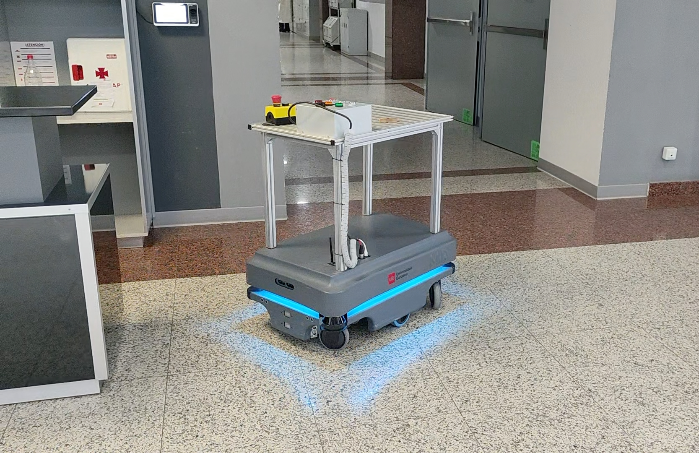
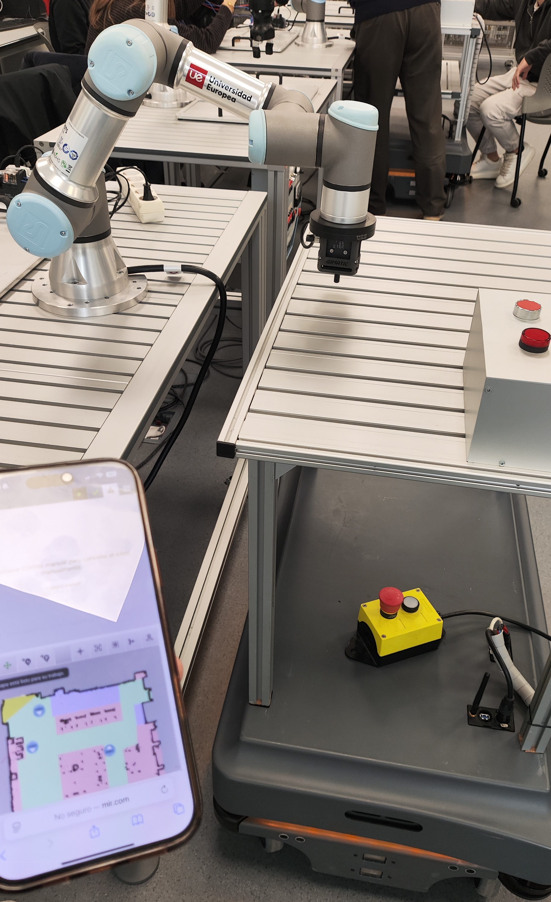

# Autonomous Mobile Robot Integration — MiR200 & UR3e

**Academic Robotics Project | Universidad Europea de Madrid | 2025–2026**

## Project Overview

Integration of a MiR200 autonomous mobile robot (AMR) with a Universal Robots UR3e collaborative robotic arm to automate material handling and transportation between workstations.

The project was developed and physically tested in a university robotics laboratory.

The main objective was to coordinate autonomous navigation, robot-to-robot communication and material manipulation within a single automated workflow.

## Technologies and Equipment

- **MiR200:** autonomous mobile robot for material transport
- **UR3e:** six-axis collaborative robotic arm
- **MiR Robot Interface:** map configuration and mission programming
- **Navigation:** localization, path planning and obstacle avoidance using the robot's integrated capabilities
- **Digital I/O:** coordination and status signaling between robotic systems
- **Industrial automation:** sequential control, mission logic and functional testing

## System Architecture

The system integrates two robotic platforms with different responsibilities.

### MiR200 — Mobile Platform

- Configuration of navigation maps
- Definition of permitted, restricted and low-speed zones
- Programming of autonomous transport missions
- Navigation between predefined workstations

### UR3e — Robotic Manipulator

- Material handling at the loading station
- Execution of programmed manipulation sequences
- Coordination with the MiR200 through control signals

## Operational Workflow

1. The MiR200 navigates autonomously to the UR3e workstation.
2. Upon arrival, a control signal initiates the coordinated loading sequence.
3. The UR3e manipulates and places the parts onto the mobile platform.
4. After loading is completed, the MiR200 continues to the destination station.

The complete sequence was tested using the physical robots.

## Navigation and Mission Development

The project involved configuring navigation maps for three areas:

- University robotics laboratory
- Adjacent corridor
- Building entrance hall

Navigation parameters included restricted zones, preferred routes, reduced-speed areas and predefined positions.

Additional missions and supervisory logic were developed for internal transport tasks.

## Validation and Results

The team demonstrated the coordinated operation of the MiR200 and UR3e in a real laboratory environment.

**Verified outcomes:**

- Autonomous navigation to a programmed workstation
- Coordination between the mobile robot and robotic manipulator
- Physical loading of parts onto the MiR200
- Continuation of the transport mission after loading
- Successful laboratory demonstration of the integrated sequence

These results demonstrate system integration and functional validation, rather than the development of a new autonomous navigation algorithm.

## Project Gallery

### Autonomous Mobile Robot — MiR200

The MiR200 platform used for autonomous material transportation between laboratory workstations.

### MiR200 and UR3e — Physical Integration

Laboratory setup showing the integration of the autonomous mobile robot with the UR3e collaborative manipulator.

## Video Demonstration

The following video shows selected footage from the physical
laboratory demonstration, including autonomous navigation and
robot coordination.

**[Watch the MiR200 + UR3e Demonstration](mir200-ur3e-portfolio-demo.mp4)**

*22-second edited demonstration. Recorded in a university robotics laboratory.*

## Project Limitations

- Developed in a controlled university laboratory environment
- Navigation relied on the manufacturer's integrated software
- No industrial-scale reliability or productivity benchmarks were established
- Results correspond to the academic prototype and laboratory demonstrations

## Project Team

- María Fernanda Carranza Lora
- Rafael del Castillo Shevelev
- César Steeven Malitaxi Martínez
- Jorge Riofrio Huerta
- Juan Marcos Sanjuán Rodríguez
- Pau Costa Torres

**Course:** Mobile and Service Robotics  
**University:** Universidad Europea de Madrid  
**Academic year:** 2025–2026

Collaborative academic project involving robot configuration, mission programming, system integration, testing and technical documentation.

## Documentation

Selected project photographs and technical documentation are included for portfolio purposes.

Internal laboratory credentials, network configurations and restricted access information are excluded.
